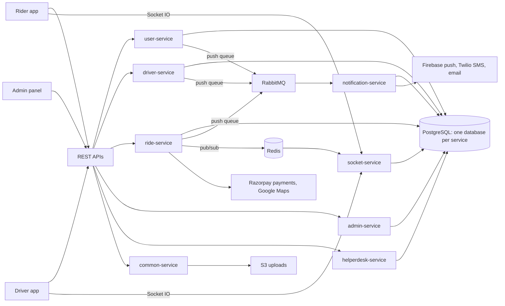

# ride-hailing-backend

The backend for a cab booking platform, built as eight Spring Boot services. It covers everything behind a rider app, a driver app and an admin panel: accounts, driver onboarding, ride booking and tracking, payments, notifications, support and live chat.

I moved this from a Node and MongoDB backend to Java. Each service owns its own PostgreSQL database and its own schema migrations.

## Architecture



Services also call each other over REST.

## Services

| Service | Port | What it does |
|---|---|---|
| `common-service` | 3004 | Shared helpers: location lookups and file uploads |
| `user-service` | 3002 | Rider accounts, profiles, addresses, wallet and referrals |
| `driver-service` | 3001 | Driver accounts, documents, wallet, nearby-driver search, reports |
| `ride-service` | 3006 | Ride booking, outstation and rental rides, pricing, ratings, payments, invoices |
| `notification-service` | 3003 | Push notifications, SMS OTP, email templates |
| `admin-service` | 3005 | Admin accounts, coupons, FAQs, CMS pages, app settings |
| `helperdesk-service` | 3009 | Support tickets and SOS alerts |
| `socket-service` | 8000 (REST), 8001 (Socket.IO) | Live ride updates, GPS and chat history |

`ridehail-common` is a shared library with the security filter, JWT and encryption helpers, the response format and common exceptions.

## What is in it

- Separate JWT secrets for riders, drivers, admins and in-app calls, checked by a shared filter
- Local, outstation and rental rides, each with its own price lookup
- Razorpay order creation for card payments
- Driver and rider wallets, referral earnings and coupons
- PDF ride invoices and reports
- Live driver location and chat over Socket.IO, with Redis pub/sub carrying updates between services
- Push, SMS and email sent through a RabbitMQ queue so ride requests are not held up by them
- Flyway migrations in every service

## Tech stack

Java 21, Spring Boot 3.3, Spring Security, Spring Data JPA, PostgreSQL, Flyway, Redis, RabbitMQ, Netty Socket.IO, Maven, Docker.

Third-party services it can talk to: Razorpay, Firebase Cloud Messaging, Twilio Verify, AWS S3, Google Maps, SMTP.

## Running it

You need Docker, or JDK 21 and Maven with PostgreSQL, Redis and RabbitMQ running locally.

1. Copy the env file and fill in your own values. The JWT and encryption secrets must be set; the provider keys (S3, Twilio, Firebase, Razorpay, mail) can stay empty for local work, and the features that need them will return an error.
   ```
   cp dev.env.example dev.env
   cp dev.env.example local.env
   ```
2. With Docker:
   ```
   docker compose up --build
   ```
   Postgres creates all the databases on first start and each service runs its migrations on boot.
3. Without Docker:
   ```
   ./dev.sh dbs       # create the databases
   ./dev.sh build
   ./dev.sh start
   ./dev.sh status
   ```

For push notifications, put your own Firebase service account file in `secrets/firebase-credentials.json` and point `GOOGLE_APPLICATION_CREDENTIALS` at it. Nothing in this repo contains real keys or credentials.

## Notes

- Services read all secrets from environment variables. The defaults in the config files are empty.
- Tests are limited. Most checking was done by running the services together.
- The REST prefixes are `/common-apis`, `/user-apis`, `/driver-apis`, `/ride-apis`, `/vehicle-apis`, `/notification-apis`, `/admin-apis`, `/helperdesk-apis` and `/socket-apis`.
